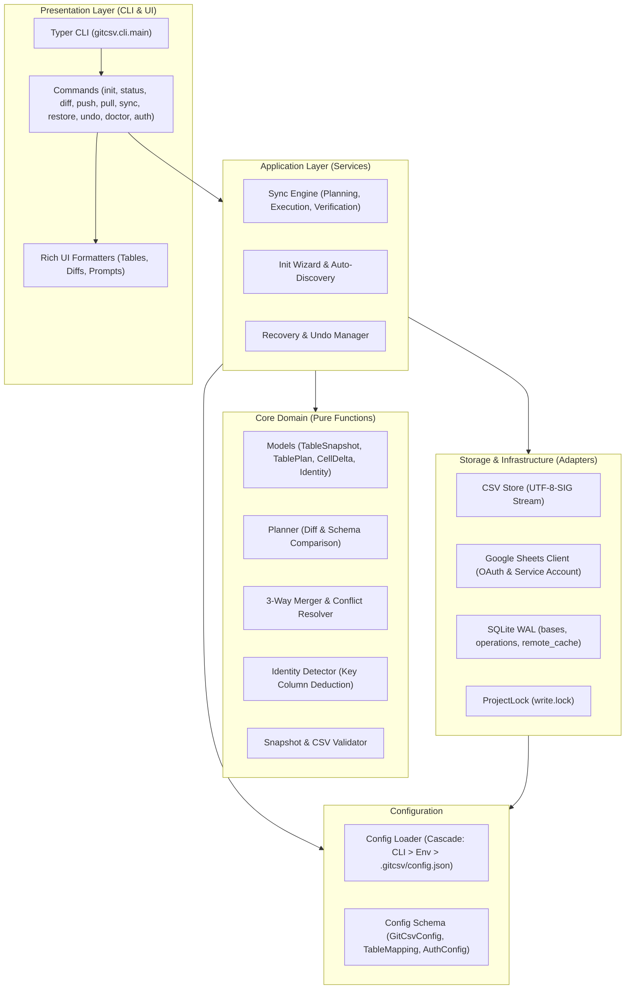

# gitcsv Architecture Specification

This document details the architectural boundaries, ownership model, and data flow of `gitcsv`.

---

## 1. Architectural Philosophy

`gitcsv` follows the **Hexagonal Architecture (Ports and Adapters)** pattern and adheres strictly to **Clean Code** and **Domain-Driven Design (DDD)**:

1. **Pure Domain (Core)**:
   - Contains mathematical, deterministic algorithms: header validation, row matching, primary key deduction, diff calculation, and 3-way cell merging.
   - Zero I/O, zero network dependencies, zero side-effects.
   - Fully testable via in-memory snapshots (`TableSnapshot`).
2. **Ports & Adapters (Storage)**:
   - Isolates external systems behind clean protocols:
     - `CSVStore`: Local disk I/O with UTF-8 BOM (`utf-8-sig`) handling.
     - `SheetsGateway`: Google Sheets REST API v4, batch reads, formula checks, and exponential backoff retry.
     - `StateDB`: SQLite WAL mode database managing BASE states and transaction logs.
     - `ProjectLock`: Atomic OS-level file lock (`O_CREAT | O_EXCL`).
3. **Application Services**:
   - Orchestrates multi-step use cases (`sync_engine`, `init_wizard`, `recovery`).
   - Ensures strict transactional safety: no write occurs without prior journal reservation in SQLite.
4. **Presentation (CLI & UI)**:
   - Driven by `Typer` and `Rich`.
   - Decoupled from core logic; consumes structured `TablePlan` and `ApplyResult` objects to render colored tables, short statuses, and diff panels.

---

## 2. Component Diagram



---

## 3. Storage & State Management

### A. The `.gitcsv/` Directory
Each project repository contains a `.gitcsv/` directory at its root:

| File | Purpose | Committed to Git? |
|---|---|---|
| `config.json` | Spreadsheet ID, CSV directory, and table-to-tab mappings | **Yes** (Shared team configuration) |
| `state.db` | SQLite database storing BASE snapshots and write journal | **No** (Local user state) |
| `write.lock` | Atomic lock preventing concurrent process corruption | **No** |
| `token.json` | Google OAuth 2.0 user access and refresh tokens | **No** (Private secret) |
| `credentials.json` | OAuth Client Secret or Service Account Key | **No** (Unless using a public Desktop App client) |

### B. SQLite Schema (`state.db`)
SQLite operates in **WAL mode (Write-Ahead Logging)** with normal synchronization for maximum performance and crash resilience:

```sql
-- The last verified, synchronized state for each table
CREATE TABLE bases (
    table_name TEXT PRIMARY KEY,
    headers_json TEXT NOT NULL,
    types_json TEXT NOT NULL,
    rows_json TEXT NOT NULL,
    updated_at TEXT NOT NULL
);

-- Transaction journal (WAL) for safety, crash recovery, and undo
CREATE TABLE operations (
    id TEXT PRIMARY KEY,
    kind TEXT NOT NULL,                -- 'push', 'pull', 'sync', 'undo'
    table_name TEXT NOT NULL,
    status TEXT NOT NULL,              -- 'pending', 'committed', 'failed', 'cancelled'
    before_local_json TEXT,
    before_remote_json TEXT,
    after_local_json TEXT,
    after_remote_json TEXT,
    started_at TEXT NOT NULL,
    error TEXT
);

-- Local cache of remote Google Sheets for offline status/diff
CREATE TABLE remote_cache (
    table_name TEXT PRIMARY KEY,
    values_json TEXT NOT NULL,
    fetched_at REAL NOT NULL
);
```

---

## 4. Concurrency & Safety Model

1. **Single Writer**: Any mutating operation (`push`, `pull`, `sync`, `undo`, `restore`) acquires `ProjectLock`. If another process is writing, it times out after 10 seconds with a clear explanation instead of deadlocking.
2. **Preflight Checking**: Before performing any external write, both sides are inspected. If the remote Sheet contains formula cells (`=SUM(...)`), the write is blocked to prevent formula destruction.
3. **Journal Before Write**: The operation is recorded as `pending` in SQLite with complete before-images **before** touching either CSV or Google Sheets.
4. **Post-Write Verification**: After writing, `gitcsv` reads back the values from disk and the Sheets API. If the values differ from the intended plan, an `OperationInterruptedError` is raised.
5. **Atomic BASE Advancement**: `bases` is updated **only after** post-write verification passes.
