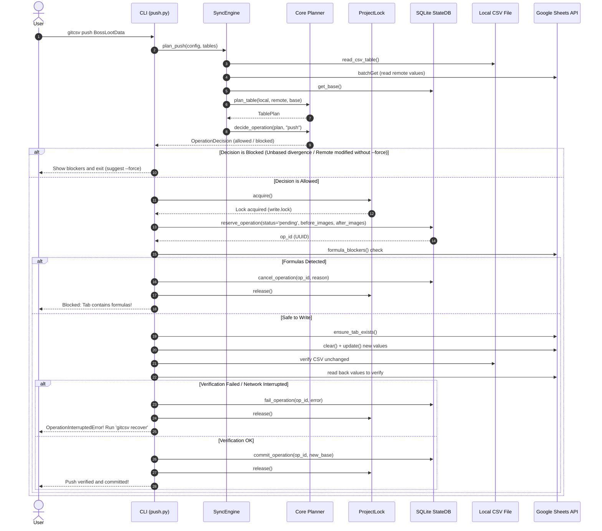
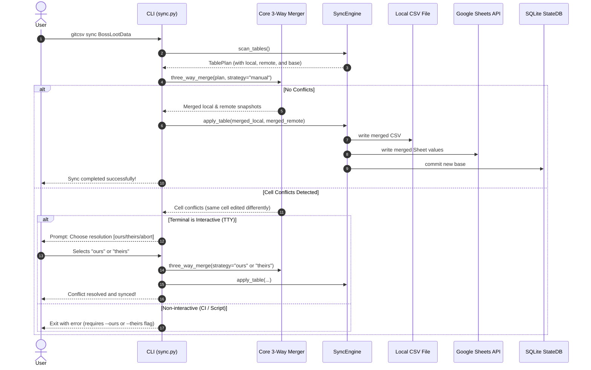

# gitcsv Execution Lifecycle & Data Flow

This document describes the exact sequence of events for all major `gitcsv` operations.

---

## 1. Push Operation Flow

A push transfers local CSV data to remote Google Sheets, provided safety checks pass.

---

## 2. Three-Way Merge (Sync) Flow

A `sync` performs an intelligent 3-way merge between local CSV, remote Sheets, and the last synchronized BASE snapshot.

---

## 3. Undo & Recovery Lifecycle

### A. The `gitcsv undo` Flow
1. User runs `gitcsv undo TABLE`.
2. `gitcsv` queries `StateDB.get_latest_operation(TABLE)` where `status = 'committed'`.
3. If found, it reads the saved `before_local` and `before_remote` snapshots.
4. Under `ProjectLock`:
   - Writes `before_local` back to disk (`Assets/CSV/TABLE.csv`).
   - Writes `before_remote` back to the Google Sheet tab.
   - Sets the BASE in SQLite to `before_local` (or deletes it if table was new).
5. User gets immediate restoration without manual data surgery.

### B. The `gitcsv recover` Flow
If a write was cut off (e.g. laptop battery died, network socket closed mid-write):
1. The operation remains in `operations` table with `status = 'pending'` or `status = 'failed'`.
2. Running `gitcsv doctor` alerts: `Found 1 pending operation requiring recovery`.
3. Running `gitcsv recover OP_ID --continue` re-applies the planned target snapshots and commits.
4. Running `gitcsv recover OP_ID --restore` rolls back to the before-images and cancels the operation.
